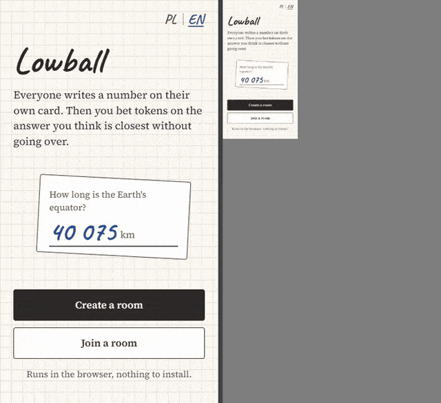

# Lowball

> Lowball to wieloosobowa gra przeglądarkowa działająca w czasie rzeczywistym. Gracze w jednym pokoju odpowiadają liczbą na to samo pytanie, a potem obstawiają żetony na odpowiedzi, które ich zdaniem są najbliżej prawdy, ale jej nie przekraczają.

Lowball is a real-time multiplayer guessing game for the browser. Everyone answers the same question with a number, then bets tokens on the answer they think is closest to the truth without going over.

Live demo: https://lowball-f337.onrender.com/ (it runs on Render's free plan, so the first load after a quiet period can take up to a minute while the server wakes up)



## How to play

1. One player creates a room and shares the five-digit code. Up to 10 players can join.
2. The game starts when at least two players are in the room and all of them are ready.
3. Each round shows a question with a numeric answer. Everyone types a guess.
4. When all guesses are in, everyone sees them sorted from lowest to highest.
5. Each player starts with 200 tokens and can spread them over any of the answers, including their own, or skip betting.
6. Bets pay out depending on the answer they were placed on:

   | Answer                                          | Payout                        |
   | ----------------------------------------------- | ----------------------------- |
   | Exactly right                                   | 2x the stake                  |
   | Closest to the correct value without going over | 1.5x the stake (rounded down) |
   | At most 25% below the correct value             | 1x the stake                  |
   | Anything else                                   | the stake is lost             |

7. Nobody drops below 25 tokens, so everyone can keep betting.
8. After seven rounds the player with the most tokens wins. The host can start a new game with everyone still in the room.

The interface and the questions are in Polish and English. Each player picks a language on the start screen or in the lobby, so people in one room can play in different languages. The browser remembers the choice.

## Architecture

```
lowball/
├── client/              Svelte 5 + Vite single-page app
│   └── src/
│       ├── App.svelte   picks the screen for the current phase
│       └── lib/
│           ├── socket.ts    typed Socket.IO connection
│           ├── game.ts      room store and actions sent to the server
│           └── *.svelte     one component per phase
├── server/              Node.js, Express and Socket.IO
│   └── src/
│       ├── index.ts         HTTP server, Socket.IO setup
│       ├── config.ts        PORT and CORS_ORIGIN from the environment
│       ├── socket/handlers.ts  validates events and calls the game functions
│       ├── game/room.ts     phase transitions
│       ├── game/scoring.ts  bet settlement
│       └── questions.json
└── shared/              types, constants and validation used by both sides
```

All game state lives on the server. Clients send actions, the server checks them, updates the room and sends the whole room state back to every player in it. The client only renders the latest `room:state`.

The game rules are in `server/src/game`, written as pure functions that take a room and return a new one (or an error). They don't touch sockets or timers, so the tests can call them directly. `socket/handlers.ts` validates payloads, calls those functions, stores the result and broadcasts it.

### Socket.IO events

Every client event takes an acknowledgement callback that receives `{ ok: true, data }` or `{ ok: false, error }`. The types for all events are defined once in `shared/src/events.ts` and used by both the client and the server.

| Direction        | Event          | Payload                                                                   | Acknowledgement data |
| ---------------- | -------------- | ------------------------------------------------------------------------- | -------------------- |
| client to server | `room:create`  | `{ name }`                                                                | `{ code, playerId }` |
| client to server | `room:join`    | `{ code, name }`                                                          | `{ code, playerId }` |
| client to server | `room:leave`   | none                                                                      | none                 |
| client to server | `player:ready` | `{ ready: boolean }`                                                      | none                 |
| client to server | `round:answer` | `{ answer: string }`                                                      | none                 |
| client to server | `round:bets`   | `{ bets: { playerId, amount }[] }`                                        | none                 |
| client to server | `game:restart` | none (host only, after the last round)                                    | none                 |
| server to client | `room:state`   | `RoomView`: code, host, phase, players, current round, results, timer end |                      |

The phases go `lobby`, `answering`, `voting`, `results`, `ranking`, and then either back to `answering` for the next round or to `finished` after the last one. `results` and `ranking` last five seconds each, on a server-side timer.

The server validates every event before it changes anything:

- names: 1 to 20 characters (letters, digits, spaces, `.`, `-`, `_`), unique within a room
- room codes: five digits
- answers: non-negative numbers, up to 15 characters
- bets: positive whole numbers, only on answers from the current round, never more than the player's tokens
- the event has to fit the current phase

An invalid event gets an error in the acknowledgement and leaves the room as it was.

### Room state and disconnects

Rooms are kept in memory on the server. When a socket disconnects, or the player clicks Leave, the server removes that player right away:

- In the lobby, the player disappears from the list. If everyone left is ready, the game starts.
- While answering, their answer is discarded. If everyone left has answered, voting starts.
- While voting, their answer stays on the board so existing bets still count, but their own bets are dropped. If everyone left has voted, the round is scored.
- If fewer than two players remain during a game, the game ends and shows the final ranking.
- If the host leaves, the next player in join order becomes host.
- When the last player leaves, the room and its timer are deleted.

## Stack

- Svelte 5 and Vite on the client. The UI mostly reacts to one state object, so Svelte keeps it small.
- Socket.IO for real-time communication. Rooms and acknowledgements are built in, and it falls back to HTTP polling when WebSockets are blocked.
- Express 5 on Node.js, serving the health check and hosting Socket.IO on the same HTTP server.
- TypeScript in all three packages.
- Vitest for tests, ESLint and Prettier for code style, GitHub Actions running lint, format check, typecheck, tests and build on every push and pull request.

## Running locally

You need Node.js 22 or newer.

```bash
git clone https://github.com/Ketnak22/lowball.git
cd lowball
npm install
npm run dev
```

`npm run dev` starts the server on http://localhost:3001 and the client on http://localhost:5173. Open the client in two or three browser tabs (or a private window) to play against yourself.

Both parts work without any configuration. To change the defaults, copy the example files and edit them:

```bash
cp server/.env.example server/.env
cp client/.env.example client/.env
```

| Variable          | Where  | Default                                                        | Meaning                                    |
| ----------------- | ------ | -------------------------------------------------------------- | ------------------------------------------ |
| `PORT`            | server | `3001`                                                         | Port of the HTTP and Socket.IO server      |
| `CORS_ORIGIN`     | server | `http://localhost:5173`                                        | Comma-separated origins allowed to connect |
| `VITE_SERVER_URL` | client | dev: port 3001 on the same host; build: the page's own address | Address of the server                      |

To test on a phone in the same network, run `npm run dev:host`. Vite prints the network address to open, and the server also accepts connections from local network addresses, so `CORS_ORIGIN` stays as it is.

Other scripts, all run from the repository root:

| Script              | What it does                                               |
| ------------------- | ---------------------------------------------------------- |
| `npm run build`     | Builds the server bundle and the client                    |
| `npm test`          | Runs the Vitest suites in `shared` and `server`            |
| `npm run lint`      | ESLint over the whole repository                           |
| `npm run format`    | Formats everything with Prettier                           |
| `npm run typecheck` | `tsc` for shared and server, `svelte-check` for the client |

## Deployment

`npm run build` builds both parts, and the server then serves the built client from `client/dist`. That way the whole game runs as one Node.js service on one address and doesn't need any environment variables. The live demo is deployed this way on Render.

## Known limitations

- Rooms exist only in the server's memory. Restarting or redeploying the server ends every game.
- The server is meant to run as a single instance.
- There are no accounts. A player is identified by their socket connection, so refreshing the page or losing the connection removes them from the room, and they can't rejoin a game in progress.
- There's no time limit for answering or voting, so one inactive player holds up the round until they act or leave.

## License

[MIT](LICENSE)
